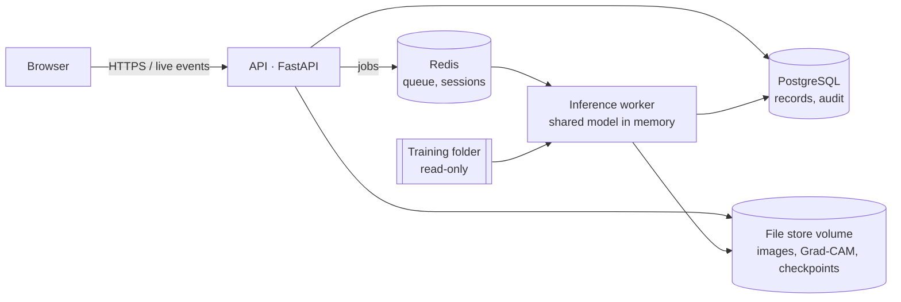

# BTDM-CDSS — Brain Tumor Diagnosis Model, Clinical Decision Support System

Research software accompanying:

> Singh D.B., Pokharel B., Pant B. *Deep learning techniques for brain tumour diagnosis via multi-source domain alignment with contrastive learning* (Part 1). npj Digital Medicine (under review).

**Research use only. Not a medical device.** The model has been evaluated only on a public, in-distribution benchmark; external validation (Part 2, ANIAS, IRC Protocol No. 520260158) is not complete. Outputs must not inform patient management.

---

## 1. What it does

| Area | Function |
|---|---|
| Analysis | Four-class MRI classification (glioma, meningioma, pituitary, no tumour) with the hybrid EfficientNet-B0–Transformer (25,057,731 parameters), per-class probabilities and Grad-CAM heat maps |
| Workspaces | Every doctor has a private, isolated workspace: they see and act only on their own patients, images, analyses and reports. Other doctors and administrators cannot open them. Only the AI model is shared. |
| Reports | Machine-generated findings, radiologist impression, sign-off; signed reports are frozen |
| Accounts | Doctors apply through a public form; an administrator approves and the system generates the username and a one-time password, which must be changed at first login |
| Model control | Checkpoints are imported from your training folder and validated automatically; a version lock keeps the Seed 42 model frozen for Part 2 |
| Uploads | PNG/JPG, DICOM (de-identified on upload), NIfTI, and zipped studies, with size and zip-bomb limits |
| Traceability | Every result records the exact checkpoint (SHA-256); an append-only audit log records logins, uploads, analyses, sign-offs, approvals and model changes |

### Roles

| Role | Worklist & upload | Run analysis | Sign reports | Manage users, registrations, models |
|---|:-:|:-:|:-:|:-:|
| Radiologist | own studies | ✓ | ✓ | |
| Referring physician | own studies | ✓ | | |
| Technologist | own studies | ✓ | | |
| Admin | | | | ✓ |

---

## 2. Architecture



Five containers, one command: `postgres`, `redis`, `api`, `worker`, `frontend`. The API never runs the model; the worker keeps the single shared model loaded and processes every doctor's analyses from one queue. Data lives in the Docker volumes `btdm_pgdata`, `btdm_redisdata`, `btdm_objectstore` and `btdm_modelcache`, so it survives restarts, rebuilds and replacing the code folder.

---

## 3. Install (macOS, Apple Silicon)

**One-time tools** (no administrator password needed):

```bash
brew install colima docker docker-compose docker-buildx
mkdir -p ~/.docker/cli-plugins
ln -sfn /opt/homebrew/lib/docker/cli-plugins/docker-compose ~/.docker/cli-plugins/docker-compose
ln -sfn /opt/homebrew/lib/docker/cli-plugins/docker-buildx ~/.docker/cli-plugins/docker-buildx
colima start --cpu 4 --memory 8 --disk 60
```

**Configure** (from this folder):

```bash
cp .env.example .env
sed -i '' "s|^POSTGRES_PASSWORD=.*|POSTGRES_PASSWORD=$(openssl rand -hex 16)|" .env
read -s "pw?Admin password (12+ characters): "; echo; sed -i '' "s|^ADMIN_BOOTSTRAP_PASSWORD=.*|ADMIN_BOOTSTRAP_PASSWORD=$pw|" .env; unset pw
```

Check that `MODEL_TRAINING_DIR` in `.env` points at your training output folder.

**Start:**

```bash
docker compose up -d --build
curl -s http://localhost:8000/health
```

The health check must show `"status":"ok"`, `"checkpoint_id":"best_model_seed42"` and `"checkpoint_matches_manuscript":true`. Then open **http://localhost:3000** and log in as `admin`.

On Linux, install Docker Engine with the Compose plugin and run the same Configure and Start steps (use `sed -i` without `''`).

---

## 4. Everyday use

| Task | How |
|---|---|
| Start | double-click **start-all.command**, or `colima start` then `docker compose up -d` |
| Stop (data kept) | double-click **stop-all.command**, or `docker compose down` |
| Status | `docker compose ps` and `curl -s http://localhost:8000/health` |
| Live logs | `docker compose logs -f worker` (Ctrl + C stops watching, not the app) |
| Apply code changes | `docker compose up -d --build` |

**Never run `docker compose down -v`** — the `-v` deletes all data.

### Accounts

1. A doctor opens the login page → **Request an account** and submits name, email, phone, NMC number, specialty, institution and role.
2. The admin opens **Admin → Doctor registrations**, reviews, and clicks **Approve** (or **Reject** with a reason).
3. The system creates the account with a user ID of 7–8 characters (`rad-###`, `ref-###`, `tech-###`) and an **8-character one-time password**, shown **once**. Hand it to the doctor in person or by phone; no email is sent.
4. At first login the doctor must set their own password.

**Password rules** (enforced by the server, shown in every form): 8–64 characters, at least one letter and one number, not containing the user ID, not a common password. Generated one-time passwords are 8 characters with upper case, lower case and a digit, without look-alike characters, and stop working once replaced. Passwords an admin sets under **Admin → Users** are also temporary. Adjust with `PASSWORD_MIN_LENGTH`, `PASSWORD_MAX_LENGTH` and `GENERATED_PASSWORD_LENGTH` (6–16) in `.env`.

The admin can also create, disable and delete accounts under **Admin → Users**. Ten failed logins for one username within 15 minutes lock that username for 15 minutes.

### Command-line account administration

Run from the project folder (the app must be running):

| Task | Command |
|---|---|
| List accounts (with study counts) | `docker compose exec api python -m app.manage users` |
| New one-time password (8 characters, must be changed) | `docker compose exec api python -m app.manage reset-password rad-002` |
| Disable / re-enable | `docker compose exec api python -m app.manage disable rad-002` (or `enable`) |
| Delete a test account | `docker compose exec api python -m app.manage delete-user rad-002` |
| Delete it **and erase its patient studies** | `docker compose exec api python -m app.manage delete-user rad-002 --with-studies` (asks you to type the user ID) |
| List / remove registration requests | `docker compose exec api python -m app.manage registrations` · `delete-registration REG-…` · `purge-registrations --status rejected` |

The bootstrap `admin` cannot be deleted or disabled here. Deleting an account also removes its registration record. Generated user IDs continue from the highest remaining number, so removing test accounts lets the next approval reuse `rad-002`. Every action is written to the audit log.

### Analysis

A doctor logs in, clicks **+ Upload study** on **My worklist**, opens the study and clicks **Run analysis**. Status moves Queued → Analysing → result, pushed live to the browser. Radiologists add an impression and sign.

---

## 5. Model, training folder and version lock

`MODEL_TRAINING_DIR` is mounted read-only into the worker. Every 30 seconds new or changed `.pt`/`.pth` files matching `MODEL_WATCH_INCLUDE` are imported once they stop changing, then validated: exact weight-key match, 25,057,731 parameters, fixed-input smoke test. Wrapped (`model_state_dict`) and DataParallel checkpoints are accepted. Files that are not this model (baselines, optimizer states) are listed as *failed* and never used.

| `MODEL_LOCKED` | Behaviour |
|---|---|
| `true` (default) | `best_model_seed42` is pinned when first found and stays active. Other checkpoints are imported and validated but **not used**. Required for the whole of Part 2. |
| `false` | The newest validated imported file becomes active automatically, swapped in between jobs. **Development only** — with the whole `Modeltrained` folder connected this could activate an ablation or cross-validation model. |

Seed 42 checkpoint SHA-256: `604e1b4191cd27fc14a8500d613578a137f31ad98b742b765e6a59ba794abce2`. Published weights: https://github.com/neurodxai-tech/BTDM-CDSS/releases/download/v1.2.1/BTDM-CDSS_model_seed42.pth.

---

## 6. Backup and restore

Run from this folder:

```bash
mkdir -p ~/btdm-backups
docker compose exec -T postgres pg_dump -U btdm btdm > ~/btdm-backups/db-$(date +%F).sql
docker run --rm -v btdm_objectstore:/data:ro -v ~/btdm-backups:/backup alpine tar czf /backup/files-$(date +%F).tar.gz -C /data .
cp .env ~/btdm-backups/env-$(date +%F).backup
```

Back up all three together: database rows point to stored files, and `.env` holds the database password. Keep backups on an encrypted drive — they contain patient-derived data.

Restore into a fresh installation (with the same `.env`):

```bash
docker compose up -d postgres
docker compose exec -T postgres psql -U btdm btdm < ~/btdm-backups/db-YYYY-MM-DD.sql
docker run --rm -v btdm_objectstore:/data -v ~/btdm-backups:/backup alpine tar xzf /backup/files-YYYY-MM-DD.tar.gz -C /data
docker compose up -d
```

## 7. Replacing or upgrading the code

Data is in Docker volumes, not in this folder. To move to a new copy of the code:

1. `docker compose down` in the old folder (no `-v`), if it still exists.
2. Put the new folder in place and restore `.env` — **the database password must stay the same**. Either copy the old `.env`, or run `./recover-env.sh`, which restores it from `~/btdm-env-backup` or, failing that, from the running containers.
3. `docker compose up -d --build` in the new folder. The database schema is upgraded automatically.

---

## 8. Serving other computers (hospital network)

By default the app is reachable only from this computer. To serve a network: run it on a server, put an HTTPS reverse proxy (e.g. Caddy or nginx) in front of ports 3000 and 8000, set `PUBLIC_APP_URL` and `PUBLIC_API_URL` in `.env` to the proxy addresses, and rebuild. Never expose ports 3000/8000 directly without HTTPS. Confirm the hosting arrangement with the institution's IT and ethics requirements before real patient data is used.

---

## 9. Security and data handling

- Passwords: PBKDF2-SHA256 with per-user salt; sessions are random tokens stored hashed in Redis. A session ends after 30 minutes of inactivity (`SESSION_IDLE_MINUTES`) or 12 hours at most, and the browser signs itself out when idle. Login lockout after repeated failures.
- Workspace isolation: every study endpoint (view, analyse, results, Grad-CAM, live status, report, sign, delete) checks ownership on the server; anyone else — another doctor or an administrator — gets 404. Worklists list only the caller's own studies.
- Accounts that own patient data cannot be deleted, only disabled, so a workspace is never orphaned or exposed.
- Enable **FileVault** (macOS disk encryption) on the host so stored images and backups are encrypted at rest.
- DICOM headers are de-identified at upload (identifiers and dates blanked, UIDs replaced, private tags removed). **Burned-in text in the pixels is not removed** — de-identify at source.
- Upload limits: 200 MB per file, 500 MB per request, 1 GB expanded zip, 5,000 entries, compression ratio ≤ 100.
- Containers run as a non-root user; the training folder is mounted read-only.

## 10. Tests

```bash
cd btdm-backend
pip install -r requirements-api.txt fakeredis "moto[s3]"
for t in tests/test_*.py; do PYTHONPATH=. python "$t" || break; done
```

The suite covers uploads and de-identification, the job queue and live events, per-doctor isolation, registration and approval, model import, validation, the lock and hot-swapping, sessions and lockout, the audit log and persistence. It runs without Docker or PyTorch.

## 11. Known limitations

No email delivery (credentials are handed over manually); no SSO; CPU inference unless a GPU is configured; the schema is upgraded by the application at start-up (adopt Alembic migrations before large schema changes); confidence values are uncalibrated softmax; multi-image consensus and attention-derived lesion measurements are experimental and were not evaluated in Part 1.
